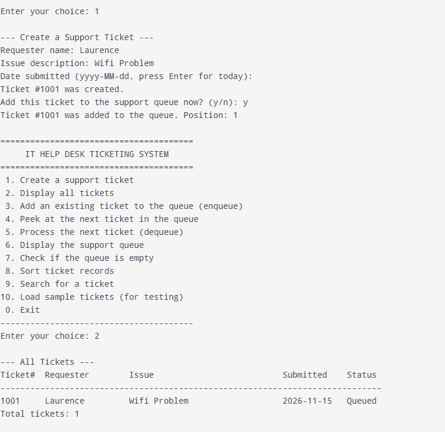
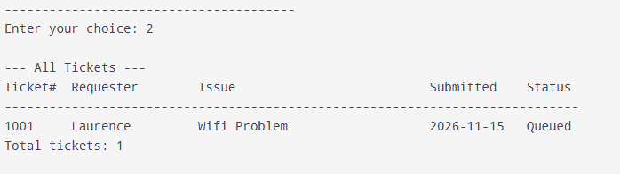
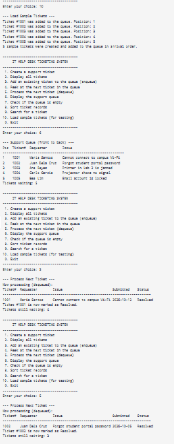
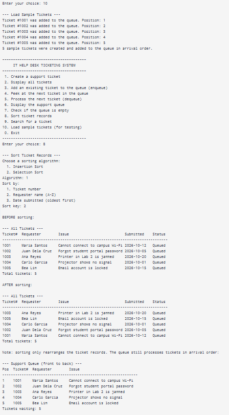
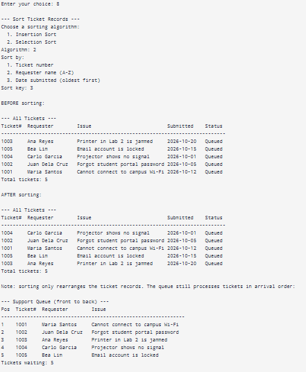
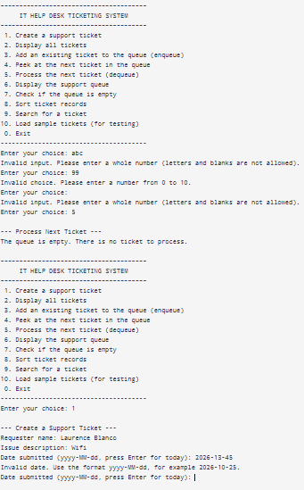

# IT Help Desk Ticketing System

A console-based Java application that manages IT support tickets using **manually implemented sorting algorithms** (Insertion Sort and Selection Sort) and a **FIFO queue**. It is written in a **procedural style with no OOP**: one `Main` class, static methods, and parallel `ArrayList`s.

Course: IT2B Data Structures and Algorithms (Capstone Project)

---

## Project Description

An IT help desk receives support requests from students and employees faster than it can solve them. If requests are handled in random order, people who asked first can be left waiting while later requests get attention, and staff have no easy way to review, organize, or look up the tickets.

This system solves that in two ways:

- **A FIFO queue** guarantees fairness. The first ticket added to the queue is the first one processed.
- **Sorting algorithms** let staff organize the full list of ticket records (by ticket number, requester name, or date submitted) for review and reporting, **without** changing the order in which tickets are processed.

## Objectives

1. Implement sorting algorithms to arrange ticket records by a chosen criterion.
2. Apply queue operations (enqueue, dequeue, peek, display, empty check) using the FIFO principle.
3. Use Java ArrayLists to store and manage related ticket information.
4. Apply loops, conditional statements, methods, and input validation.
5. Build a functional console application that integrates sorting and queues in one workflow.
6. Demonstrate the correct operation of the program and explain the logic behind it.

## Use Cases and Features

| Menu option | What it does |
|---|---|
| 1. Create a support ticket | Stores a new ticket (number, requester, issue, date, status). Optionally enqueues it right away. |
| 2. Display all tickets | Shows every stored ticket in its current list order. |
| 3. Add an existing ticket to the queue | **Enqueue**: adds a created ticket to the back of the support queue. |
| 4. Peek at the next ticket | Shows the front ticket **without** removing it. |
| 5. Process the next ticket | **Dequeue**: removes the front ticket and marks it `Resolved`. |
| 6. Display the support queue | Lists waiting tickets from front to back. |
| 7. Check if the queue is empty | Reports whether any tickets are waiting. |
| 8. Sort ticket records | Choose Insertion or Selection Sort and a key; shows records **before and after**. |
| 9. Search for a ticket | Find by ticket number or by (partial) requester name. |
| 10. Load sample tickets | Adds 5 unsorted sample tickets to the queue for quick testing. |
| 0. Exit | Ends the program properly. |

Ticket status flow: `Pending` (created) → `Queued` (in the support queue) → `Resolved` (processed).

Input handling: every prompt reads a whole line and validates it. Letters, blanks, out-of-range menu choices, invalid dates, and empty fields produce a clear message and ask again, so the program does not crash. Empty-list, empty-queue, and not-found cases each print their own message.

## Data Structure Explanation

### ArrayLists (record storage)

Each ticket is stored across five **parallel ArrayLists**. Index `i` in every list refers to the **same ticket**.

```java
ArrayList<Integer> ticketNumbers   // e.g. 1001
ArrayList<String>  requesterNames  // e.g. "Maria Santos"
ArrayList<String>  issues          // e.g. "Printer in Lab 2 is jammed"
ArrayList<String>  datesSubmitted  // yyyy-MM-dd
ArrayList<String>  statuses        // Pending / Queued / Resolved
```

- **Add:** a value is added to all five lists, so they always have the same length.
- **Sort:** the helper `swapRecords(i, j)` swaps position `i` and `j` in **all five lists** at once, so fields never get mismatched.
- **Lookup:** `findTicketIndex(number)` finds a ticket's current position by its ticket number.

### Queue (processing order)

The support queue is `Queue<Integer> supportQueue = new LinkedList<>()` from Java Collections. It stores **ticket numbers**, not list positions.

- **Enqueue:** `offer(number)` adds to the back.
- **Dequeue:** `poll()` removes from the front and the ticket is marked `Resolved`.
- **Peek:** `peek()` reads the front without removing it.
- **Display / empty check:** iteration and `isEmpty()`.

**Why ticket numbers instead of indexes?** Sorting moves records to new positions in the ArrayLists, but a ticket number never changes. Because the queue holds ticket numbers, sorting can never break the queue or change who is served next. The queue is real part of the workflow: tickets only become `Resolved` by being dequeued.

## Sorting Algorithm Explanation

Both algorithms are written by hand. No `Collections.sort()`, `Arrays.sort()`, `List.sort()`, or comparators are used. Both can sort by ticket number, requester name (A-Z), or date submitted (oldest first), using the shared `compareRecords()` method.

### 1. Insertion Sort (`insertionSort`)

- **How it works:** The left part of the list is always sorted. Each new record is slid left, swap by swap, until it reaches its correct place.
- **Purpose in the app:** organize the ticket list for review.
- **Why it suits this use case:** it is stable (tickets with equal keys keep their order) and is fast when the list is already mostly sorted, which is typical for a help desk where new tickets are added in roughly date order.

### 2. Selection Sort (`selectionSort`)

- **How it works:** Repeatedly find the smallest remaining record and swap it into the next position of the sorted part.
- **Purpose in the app:** organize the ticket list for review, with few swaps.
- **Why it suits this use case:** it makes at most n-1 swaps, and each swap moves five parallel lists, so fewer swaps means less work. It is also easy to trace step by step.

### How sorting is used in the app

Menu option 8 asks for the algorithm and key, prints the records **before** sorting, sorts, then prints them **after**. It then shows the queue again to prove that sorting did **not** change the FIFO processing order.

## How to Run the Program

Requirements: JDK 11 or later (check with `java -version` and `javac -version`).

From the project root folder:

```bash
javac -d out src/Main.java
java -cp out Main
```

Or, without an output folder:

```bash
javac src/Main.java
java -cp src Main
```

Tip: choose menu option **10** first to load sample tickets, then try the queue and sorting options.

## Screenshots of the System

> The screenshots below must be real output from the running program. Place the images in the `screenshots/` folder using these exact names.

### 1. Main menu


*Caption: The main menu showing all available operations.*

### 2. Adding and displaying records


*Caption: Creating tickets and displaying the stored records.*

### 3. Queue operations


*Caption: Enqueue, peek, dequeue, and display of the support queue.*

### 4. FIFO behavior


*Caption: The first ticket added is the first ticket processed.*

### 5. Sorting algorithm 1: Insertion Sort


*Caption: Ticket records before and after Insertion Sort.*

### 6. Sorting algorithm 2: Selection Sort


*Caption: Ticket records before and after Selection Sort.*

### 7. Input validation


*Caption: Error messages for invalid menu choices, letters, blank input, and an empty queue.*

## Repository Structure

```
DSA-Java-Sorting-Queue-Capstone/
├── src/
│   └── Main.java
├── screenshots/
├── .gitignore
├── AGENT.md
└── README.md
```
